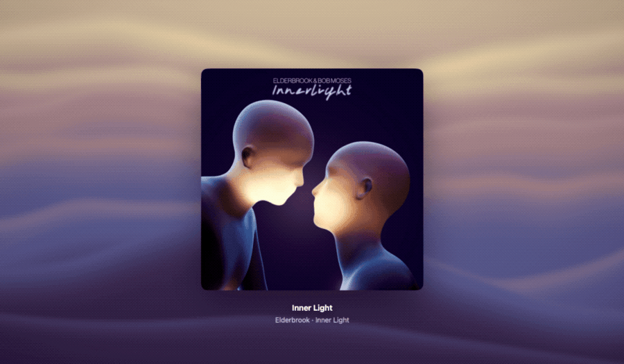

<h1 align="center">Gravitune</h1>

<p align="center">
  A macOS music visualizer that turns the album artwork of what you're playing into a living, flowing background.
</p>

<p align="center">
  
</p>

## Features

- **Follows your player:** shows the current track from Spotify or Apple Music.
- **Colors from the artwork:** extracts a palette from each cover and blends into it smoothly.
- **Three Metal visual styles:** Liquid, Ocean and Aurora, with adjustable speed, size, warp and resolution.
- **Playback controls:** play, pause, skip, seek, shuffle, repeat and volume.
- **Made for the big screen:** send the visual to a TV over HDMI or AirPlay while controlling it from your Mac.
- **Stays awake:** keeps the display on while music is playing.
- **Localized:** available in English and Spanish.

The visual reacts to the artwork, not to the audio: Gravitune doesn't capture or analyze sound.

## Requirements

- macOS 26.0 or later
- Xcode 27 or later to build from source
- Spotify or Apple Music

## Getting started

1. Clone the repository and open `gravitune.xcodeproj`.
2. In the **gravitune** target, under **Signing & Capabilities**, select your own team.
   The project uses the author's team by default, so signing fails without this change.
3. Build and run with ⌘R.

The first time Gravitune reads a player, macOS asks for permission to control it.
If you deny it, you can enable it later in **System Settings › Privacy & Security › Automation**.

## Keyboard shortcuts

| Shortcut | Action |
| --- | --- |
| Space | Play or pause |
| ⌘→ | Next track |
| ⌘← | Previous track |
| H | Show or hide the controls |

## Architecture

The app follows MVVM, with the reusable engine in a local Swift package:

```
gravitune/
├── App/          Entry point and menu commands
├── Models/       Plain data types
├── Services/     Display routing and sleep prevention
├── ViewModels/   Observable state and logic, one per feature
├── Views/        SwiftUI layout and transient UI state
└── Resources/    Assets, app icon and string catalogs
gravituneTests/   View model tests
Packages/VisualEngine/
├── Sources/VisualEngine/  Metal renderer, shaders and palette extraction
└── Sources/NowPlaying/    Player monitoring through Apple Events
```

Views only talk to view models, and view models reach external systems through the
`NowPlayingProviding` and `DisplayRouting` protocols, which tests replace with test doubles.

## Testing

Run the tests of the app and of the package:

```sh
xcodebuild test -project gravitune.xcodeproj -scheme gravitune -destination 'platform=macOS'

cd Packages/VisualEngine
xcodebuild test -scheme VisualEngine-Package -destination 'platform=macOS'
```

Set `SNAPSHOT_DIR` to a folder to export the frames rendered by the renderer tests as PNG files.

## Contributing

Contributions are welcome. The `main` branch is protected, so all changes go through a pull request:

1. Fork the repository and create a branch from `main`.
2. Make your change, adding tests where it makes sense.
3. Run the tests and open a pull request against `main`.

Every pull request needs an approving review from the maintainer before it can be merged.

## Privacy

Gravitune has no accounts or analytics. It reads the current track from your player and downloads
its artwork from the link the player provides. When there's no artwork, it searches for it using
the artist and album name in the public iTunes Search API.

## License

Gravitune is available under the [MIT License](LICENSE).

Spotify and Apple Music are trademarks of their respective owners. This project isn't affiliated
with or endorsed by them.
